# RestaurantOS

Polskie menu QR, wspólny koszyk stolika i aplikacja Android z trybami Kelner, Kuchnia i Manager. Wersja demonstracyjna używa prawdziwej bazy PostgreSQL i symuluje wystawianie paragonu.

## Zrzuty ekranu

<details open>
<summary>Kelner</summary>

**Mapa sali**

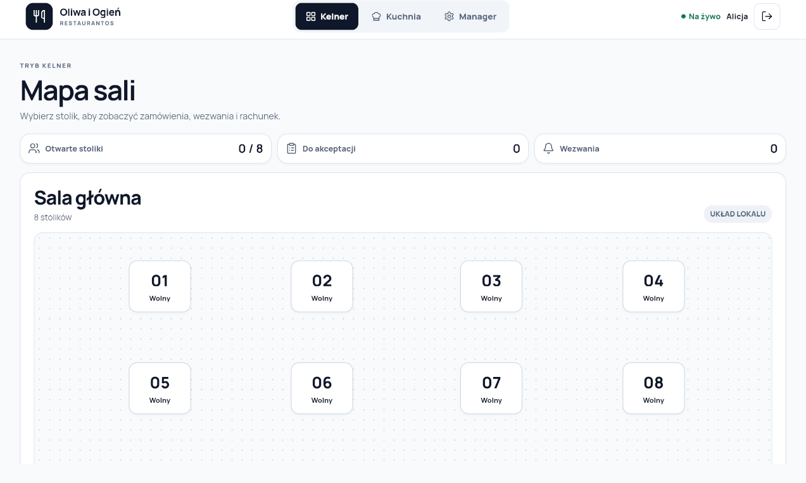

**Otwarcie stolika**

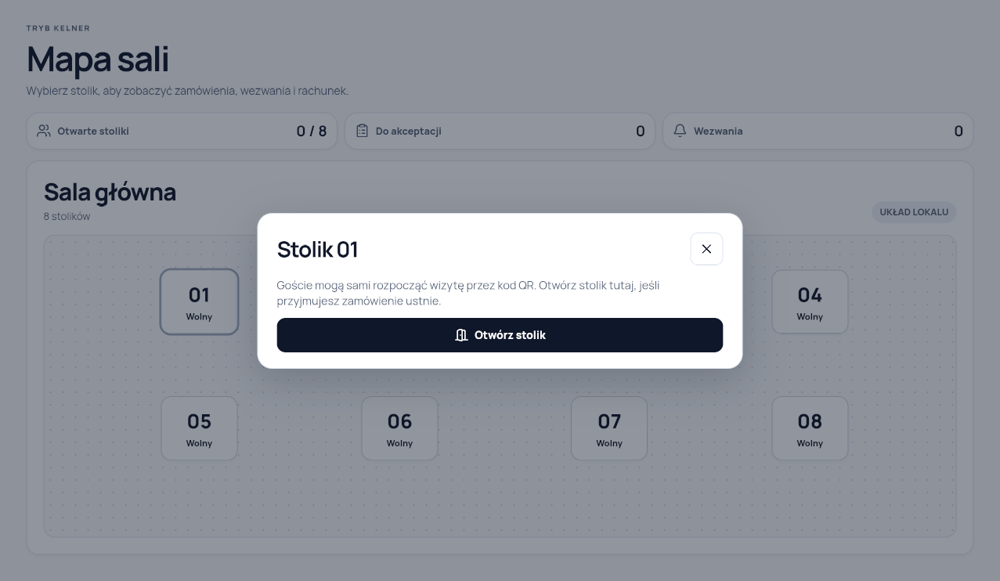

**Szczegóły stolika**

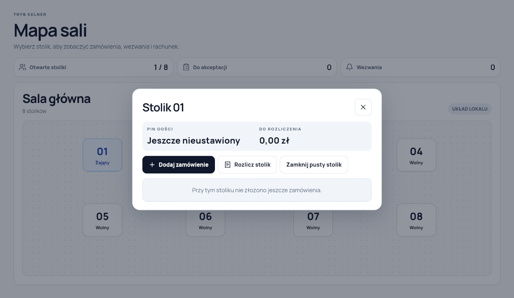

**Zamówienie od kelnera**

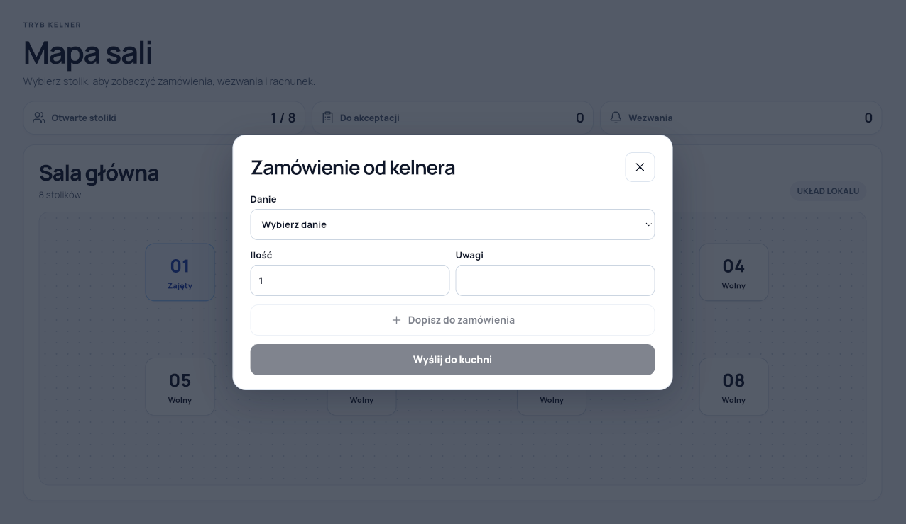

</details>

<details>
<summary>Kuchnia</summary>

**Kolejka zamówień**

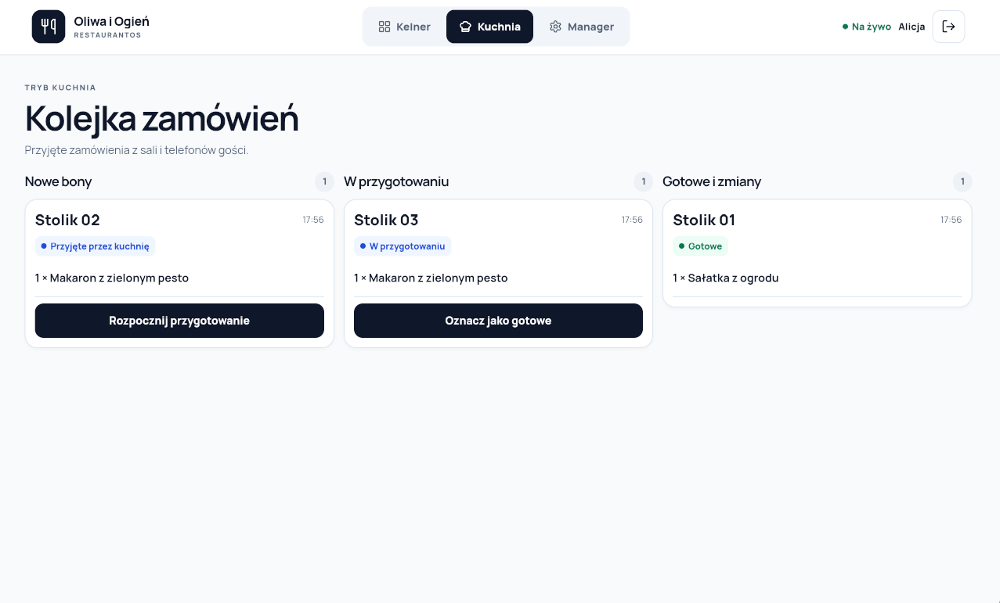

</details>

<details>
<summary>Manager</summary>

**Zarządzanie menu**

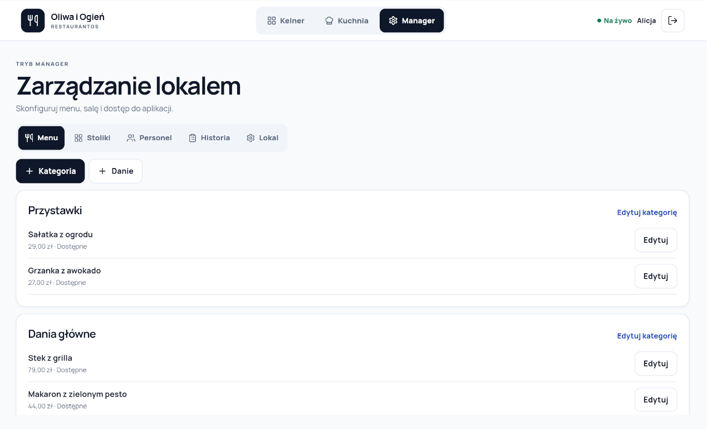

**Edycja planu sali**

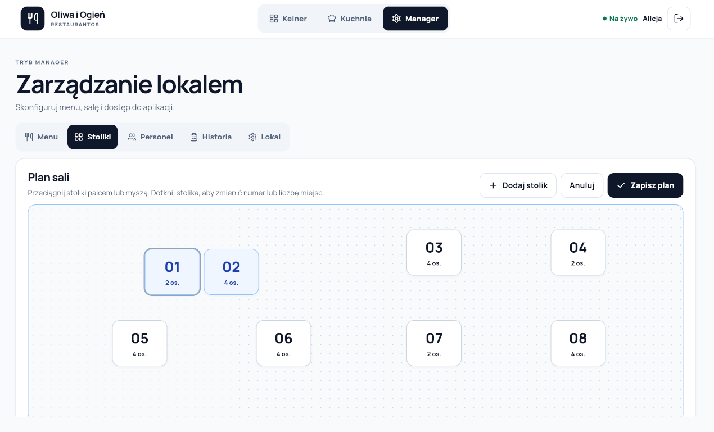

**Kod QR stolika**

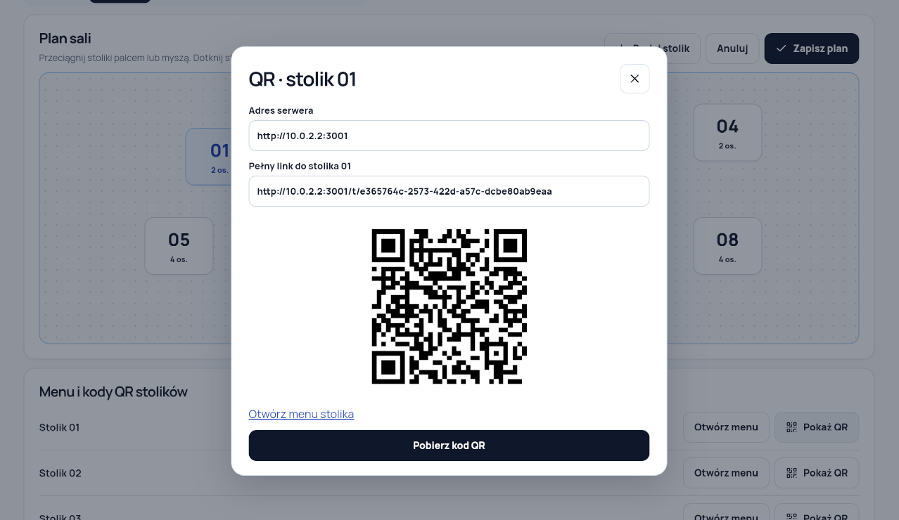

**Konta i uprawnienia**

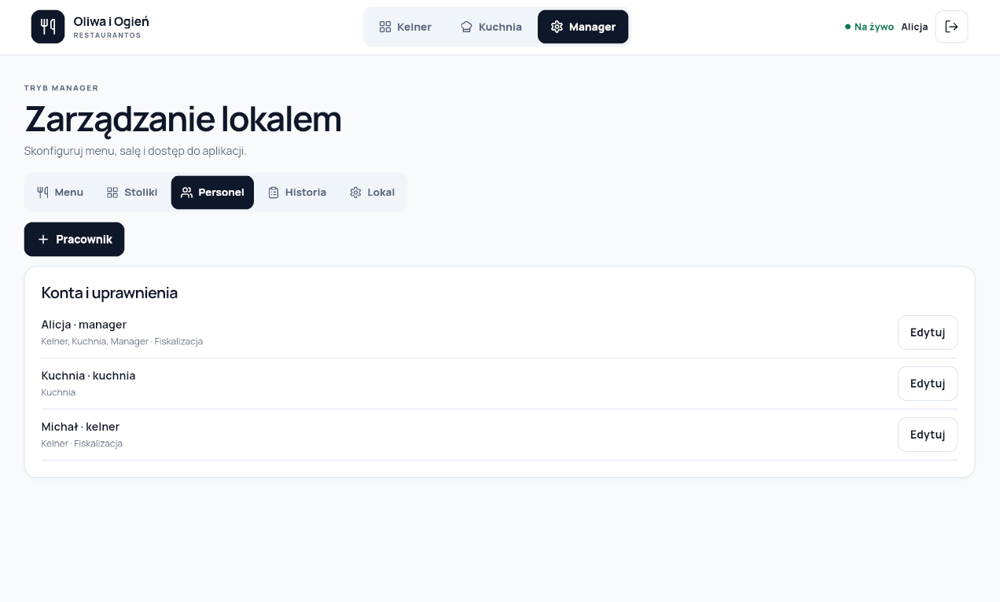

**Edycja konta pracownika**

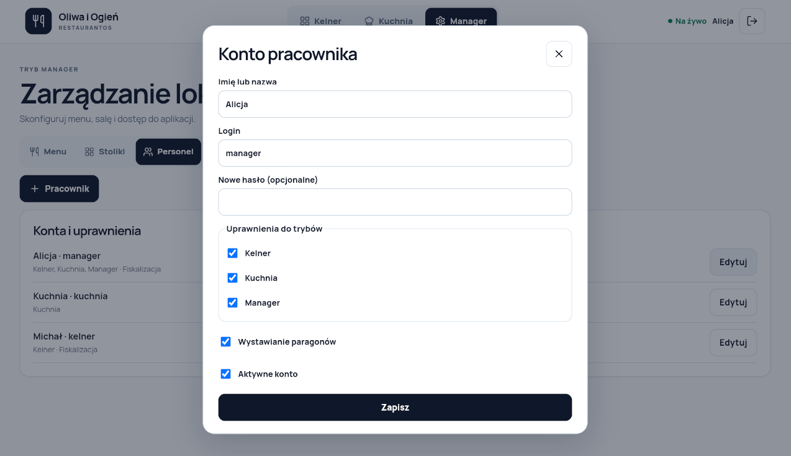

**Historia wizyt i rozliczeń**

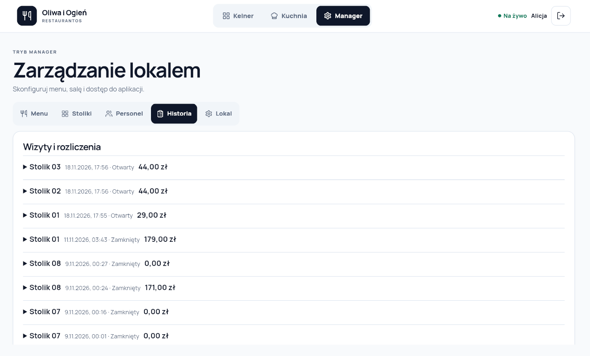

**Edycja danych lokalu**

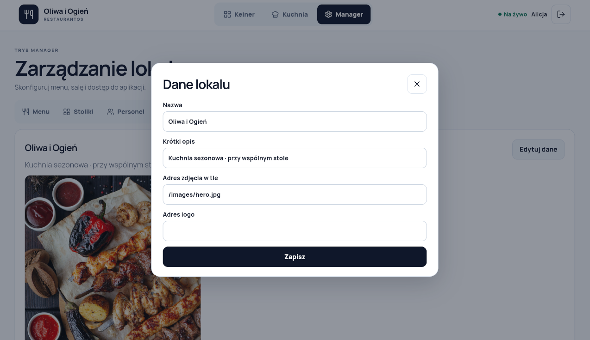

</details>

## Demo na Windows

W katalogu projektu uruchom:

```powershell
npm.cmd ci
npm.cmd run demo
```

Pierwsze uruchomienie pobierze lokalny PostgreSQL do `.local`, wykona migracje i załaduje przykładową restaurację. Dane demo są zachowywane między uruchomieniami. Demo domyślnie nasłuchuje na adresie lokalnym komputera.

- Wybór stolika: [http://localhost:3001/](http://localhost:3001/). Każdy stolik otwiera własny link do menu. Przy pierwszym dodaniu dania na wolnym stoliku gość ustawia własny sześciocyfrowy PIN. Pozostałe osoby przy stole wpisują ten sam PIN. Przeglądarka zapamiętuje dostęp do bieżącej wizyty, a PIN jest widoczny w szczegółach stolika w trybie Kelner. Po rozliczeniu stolik jest znów dostępny dla nowych gości.
- Obsługa w przeglądarce: [http://localhost:3001/staff?venue=oliwa](http://localhost:3001/staff?venue=oliwa). Lokal **oliwa**, login **manager**, hasło **demo1234**. Konto ma dostęp do wszystkich trzech trybów. Konta **kelner** i **kuchnia** mają to samo hasło i dostęp tylko do swojego trybu.
- Gość wysyła koszyk. W trybie **Kelner** wybierz ten sam stolik i naciśnij **Akceptuj**. W trybie **Kuchnia** przesuń bon przez **W przygotowaniu** i **Gotowe**. W trybie **Kelner** oznacz zamówienie jako podane, wybierz **Rozlicz stolik** i przejdź przez symulację wydruku.
- W trybie **Manager → Stoliki** wejdź w edycję planu, przeciągnij stoliki i zapisz układ. Możesz też dodać stolik i nadać mu numer. Przy tworzeniu lub edycji dania wybierz zdjęcie JPEG, PNG lub WebP do 5 MiB. Plik trafia do lokalnego katalogu `.local/uploads/products`, a baza przechowuje jego adres.

## Emulator Androida

Zostaw uruchomione demo. W drugim terminalu uruchom:

```powershell
powershell -ExecutionPolicy Bypass -File .\scripts\emulator.ps1
```

Skrypt tworzy wirtualny Pixel Tablet z Androidem 35, uruchamia go, instaluje debug APK i otwiera RestaurantOS. Opcja `-Build` przebudowuje APK. W aplikacji wpisz **oliwa**, **manager**, **demo1234**. Menu gościa możesz równolegle otworzyć w przeglądarce na Windows. Aplikacja debug łączy się z serwerem hosta przez adres emulatora `http://10.0.2.2:3001`.

Na innym komputerze zainstaluj JDK 17 lub 21 oraz pakiety Android SDK: Command-line Tools, Platform-Tools, Emulator, Android SDK Platform 35, Build-Tools 35.0.0 i obraz Google APIs x86_64 dla Androida 35. Włącz akcelerację wirtualizacji Windows i ustaw `ANDROID_HOME` na katalog SDK, jeśli jest niestandardowy. Skrypt rozpoznaje też SDK w `.local/android-sdk`. APK debug znajduje się w `android/app/build/outputs/apk/debug/app-debug.apk`.

Aplikacja ma kontener Kotlin/WebView i współdzieli widoki React z testowym adresem `/staff`. Pełny kiosk wymaga zarządzanego urządzenia Android Enterprise i dopuszczenia pakietu `pl.restaurantos.tablet` do Lock Task przez administratora. Konfiguracja zarządzana obsługuje `server_url`, `venue` oraz `mode` (`WAITER`, `KITCHEN`, `MANAGER`). Debug na emulatorze służy do sprawdzania interfejsu i obiegu zamówień. Kiosk odbiera się na zarządzanym tablecie.

## Uruchomienie z własną bazą

Skopiuj `.env.example` do `.env`, ustaw dane swojego PostgreSQL i wykonaj `npm.cmd run db:setup`. Lokalny PostgreSQL można uruchomić przez `docker compose up -d`. Utwórz lokal przez `npm.cmd run seed` z ustawionymi `BOOTSTRAP_SLUG`, `BOOTSTRAP_NAME`, `BOOTSTRAP_USER` i `BOOTSTRAP_PASSWORD`. Zbuduj aplikację webową przez `npm.cmd run build` i uruchom API przez `npm.cmd run api`. W środowisku lokalu używaj HTTPS oraz `DEMO_MODE=0`.

Wydruk demonstracyjny jest symulowany. Odbiór fiskalizacji wymaga wyboru jednego modelu, podłączenia sterownika producenta do stanowiska barowego i weryfikacji papierowego wydruku, wyniku po przerwaniu łączności oraz przebiegu płatności. API przechowuje zlecenie przed wydrukiem i blokuje ponowienie po niepewnym wyniku. Po odrzuceniu karty na zewnętrznym terminalu rachunek pozostaje otwarty do rozliczenia.

## Weryfikacja

```powershell
npm.cmd run build
npm.cmd run test:demo
```

Test używa oddzielnej bazy i portu 3002. Sprawdza ustawienie i reset PIN-u, wspólny koszyk z dwóch telefonów, kolejkę po akceptacji, zamknięcie sesji, zapis planu sali oraz przesłanie i wyświetlenie zdjęcia.

Zdjęcia w przykładowym menu pochodzą z [Unsplash](https://unsplash.com/).
